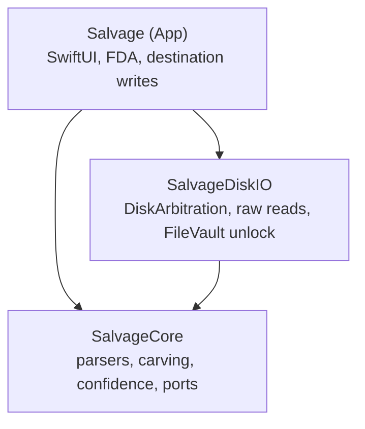
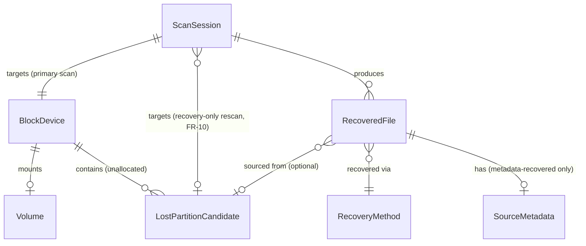

# Architecture Spine — Salvage

## Design Paradigm

**Hexagonal / Ports-and-Adapters**, three modules:

- **SalvageCore** — the domain: filesystem parsers, carving engine, partition reconstruction, recovery-confidence scoring, core entities. Defines ports (protocols) adapters must satisfy. Depends on nothing but Foundation.
- **SalvageDiskIO** — macOS adapter: DiskArbitration, raw block-device reads, FileVault unlock. Implements Core's `BlockReader` port.
- **Salvage** (app target) — UI adapter: SwiftUI, Full Disk Access handling, destination writes, update-check network call. The composition root — the only place that wires a concrete `SalvageDiskIO.RawBlockReader` into `SalvageCore`'s engine.

Chosen over a flat Core/App split because disk I/O and UI are genuinely independent concerns: a future CLI companion (Open Question 6) or a Linux/Windows port (Vision) needs a new adapter, never a Core rewrite.



## Invariants & Rules

### AD-1 — Three-module hexagonal boundary

- **Binds:** all FRs
- **Prevents:** disk-access logic leaking into SwiftUI views; UI logic leaking into the recovery engine; a Linux/Windows port requiring a Core rewrite; two unsynchronized integration points with the same Apple framework.
- **Rule:** `SalvageCore` depends on nothing but Foundation. `SalvageDiskIO` depends only on `SalvageCore` (to conform to its ports). `Salvage` (app) depends on both and is the only module permitted to construct a concrete adapter and wire it into Core. **`SalvageDiskIO` is the exclusive owner of DiskArbitration** — `Salvage` (app) never imports or calls DiskArbitration directly, including for AD-8's destination-safety check, which goes through a `SalvageDiskIO`-exposed API (enforced by AD-9).

### AD-2 — APFS parsing is original, MIT-licensed code `[ADOPTED 2026-10-31]`

- **Binds:** FR-4, FR-5, FR-9, FR-10
- **Prevents:** license contamination of the MIT codebase; a hard runtime dependency on installing a FUSE kernel extension (macFUSE) for an end-user consumer app.
- **Rule:** APFS parsing in `SalvageCore` is implemented as original Swift code, informed by Apple's public 2018 APFS Reference and independent testing. Never link, vendor, or shell out to GPL/LGPL parser code (apfs-fuse, libfsapfs, Sleuth Kit) in the shipped product. HFS+/FAT32/exFAT/NTFS/EXT2/3/4 carry no equivalent risk — their formats are properly documented via official specs (Apple TN1150; Microsoft FAT/exFAT specs) or mature, long-standing community reference work (the Linux-NTFS project's documentation for NTFS; the Linux kernel's ext4 documentation for EXT2/3/4) — so this rule binds APFS specifically; `Parsers/` as a whole may use original code throughout, or a suitable MIT-compatible third-party dependency for the non-APFS formats if one emerges — confirmed candidates exist for NTFS (the `ntfs` Rust crate, dual Apache-2.0/MIT, read-only) and EXT2/3/4 (the `ext4-view` Rust crate, same dual license), unlike APFS where no such option exists. Implementer's call for all five non-APFS formats. This is the single biggest engineering risk in the project (PRD Open Question 9); a timeboxed spike against a read-only, unencrypted volume is recommended before committing further.

### AD-3 — FileVault unlock never mounts the source

- **Binds:** FR-6, FR-15
- **Prevents:** the FR-6/FR-15 tension the PRD flagged as Open Question 10.
- **Rule:** FileVault volumes are unlocked via `diskutil apfs unlockVolume <device> -nomount`. Salvage never mounts a source volume through the normal Finder/OS path, encrypted or not. After unlock, the decrypted block device is read through the same raw-read path as any other device (AD-4) — no FileVault-specific exception to the read-only guarantee is needed. The password/recovery key is held only transiently in memory for the duration of the unlock call, never persisted, and zeroized immediately after — standard practice, stated explicitly given how central trust is to this product.

### AD-4 — Raw read path, with read-only enforced at the type level

- **Binds:** FR-15
- **Prevents:** any code path, present or future, from writing to the source disk — not just a runtime promise; two concurrent scans corrupting each other's reads on the same device.
- **Rule:** Before any scan, `SalvageDiskIO` resolves the target via `DADiskCreateFromBSDName` and unmounts it (`DADiskUnmount`, whole-disk) — Salvage never reads a device that remains mounted for normal OS use. All reads are unbuffered `open()`/`read()` on `/dev/rdiskN`. `SalvageCore`'s `BlockReader` port exposes only `read(at:count:)` — no write method exists on the type at all. `SalvageDiskIO` owns a single-session-per-device lock (an actor-held registry keyed by BSD device name): a second scan attempt against a device already under an active session is rejected with a clear error, never silently allowed to race.
  - **Boot-volume exception (v1):** the currently-running boot volume cannot be unmounted from user space while macOS is running from it — this rule cannot execute against it. v1 scopes internal-drive recovery to *non-boot* internal volumes only (a secondary internal drive, or the boot drive after the user has started up from external/recovery media). The device-picker UI (FR-1) excludes or clearly marks the live boot volume as unsupported rather than offering a scan path the architecture cannot fulfill. A live-mounted-volume read path for the running boot volume (a weaker read-only guarantee, requiring its own FR-19 disclosure) is a possible v2+ direction, not built now — see Deferred.

### AD-5 — Structured concurrency only

- **Binds:** FR-2, FR-3
- **Prevents:** Core and the UI layer independently choosing incompatible async idioms (Combine in one, delegates in another).
- **Rule:** `SalvageCore` scanning is exposed as `AsyncStream<ScanEvent>` (concrete shape fixed by AD-11). No Combine, no completion-handler APIs, anywhere in Core or DiskIO. Cancel and pause are distinct operations with different mechanisms — see AD-11; "cancel via `Task` cancellation" alone is necessary but not sufficient, corrected there.

### AD-6 — Carving signatures are declarative data

- **Binds:** FR-7, FR-8
- **Prevents:** format support becoming a ever-growing set of bespoke code paths only the original author can safely extend.
- **Rule:** File-format carving signatures (magic bytes, offsets, size heuristics, extension) are JSON definitions loaded by one generic carving engine in `SalvageCore` — never a hand-written parser subclass per format. Adding a format is a data contribution, not a code contribution (serves PRD Open Question 8 and SM-3's community-contribution goal directly). Every signature file carries a required `schemaVersion` field; the engine ignores unrecognized fields rather than rejecting the file — this is the contract that keeps independent contributors' additions (e.g. one adding `footerBytes`, another adding `maxFragments`) from silently breaking each other or the engine.

### AD-7 — Recovery confidence is one pure function

- **Binds:** FR-12
- **Prevents:** the UI silently diverging from the PRD's binary floor (metadata-recovered = High, carved = never-High).
- **Rule:** `RecoveryConfidence` is computed by exactly one pure function in `SalvageCore`, taking a `RecoveryMethod` (`.metadata` / `.carved`) plus graduated evidence (e.g. `fragmentCount: Int`, `overwriteConfidence: Double` in `0...1` — not booleans) and returning `.high` / `.medium` / `.low`. No other layer computes or duplicates this. Evidence is graduated specifically so the Medium/Low boundary (Deferred) can be tuned later from real test cases without a producer-side (carving engine, AD-6) format change — a boolean flag would foreclose that.

### AD-8 — Destination safety is a Shell responsibility, by volume identity

- **Binds:** FR-15, FR-16
- **Prevents:** a symlink or bind-mount defeating a path-string comparison; a single thrown error losing per-file success/failure granularity FR-16 requires.
- **Rule:** The destination-equals-source check (FR-15) runs in the app layer (`RecoveryDestinationWriter`), calling a `SalvageDiskIO`-exposed volume-identity comparison (never a direct DiskArbitration call per AD-1, never a path-string comparison), before any recovery write begins. Writes proceed file-by-file, each reporting its own success/failure back to the caller as a discrete result — never a single all-or-nothing batch call — so FR-16's completion summary reflects what was actually written, not the pre-recovery selection count.

### AD-9 — Core/DiskIO boundary is CI-enforced, not just reviewed

- **Binds:** AD-1
- **Prevents:** `SalvageCore` quietly importing `AppKit`/`SwiftUI`/`DiskArbitration`/`IOKit` over time — Swift Package Manager does not structurally prevent this.
- **Rule:** CI fails the build if `import AppKit`, `import SwiftUI`, or `import IOKit` appears anywhere under `SalvageCore`'s source tree, or if `import DiskArbitration` appears anywhere outside `SalvageDiskIO` (i.e., also forbidden in `SalvageCore` and in the `Salvage` app target — enforces AD-1's exclusive-ownership rule). CI additionally resolves `SalvageCore`'s full dependency graph (`swift package show-dependencies` or equivalent) and fails if any transitive dependency requires a non-portable platform framework — a direct source-tree grep alone would miss a third-party package silently reintroducing one.

### AD-10 — Build, sign, and release pipeline

- **Binds:** all FRs (release mechanism); PRD's "verifiable build provenance" NFR
- **Prevents:** an unsigned or unverifiable release undermining the trust claim (FR-17–FR-19).
- **Rule:** GitHub Actions builds signed, notarized releases from tagged commits using HSmithDev LLC's Developer ID, publishes to GitHub Releases (never the Mac App Store, per PRD Non-Goals) with published SHA-256 checksums and build logs attached. Notarization itself uses Apple's current `notarytool` CLI directly (its successor to the deprecated `altool`) — the GitHub Actions orchestration around it follows a well-established community pattern, not an Apple-published CI integration; if a wrapper Action goes unmaintained, a hand-written workflow step invoking `notarytool` directly is the documented fallback.

### AD-11 — Scan event protocol: shape, pause vs. cancel, and mid-scan unlock

- **Binds:** FR-2, FR-3, FR-6, FR-9, FR-10
- **Prevents:** Core and the UI building incompatible `ScanEvent` shapes; "pause" and "cancel" being conflated into one unimplementable mechanism; a lost-partition-turns-out-encrypted scenario having no agreed integration contract.
- **Rule:** `ScanEvent` is a closed enum with exactly these cases: `.progress(bytesScanned: Int64, totalBytes: Int64)`, `.found(RecoveredFile)`, `.lostPartitionFound(LostPartitionCandidate)`, `.unlockRequired(BlockDevice)`, `.error(ScanError)`, `.completed`. **Cancel** is Swift `Task` cancellation — terminal, no resume, as AD-5 states. **Pause** is a separate mechanism: the scan loop awaits an actor-held resumable gate without cancelling the underlying `Task`, so the same `Task` continues when ungated; `ScanSession` additionally checkpoints its current byte offset after each unit of work, giving a cold-start (app relaunch) a checkpoint to resume from independent of the in-process pause path. A FileVault-encrypted volume discovered mid-scan (e.g. inside a lost partition, not known up front) yields `.unlockRequired` and the scan pauses (same mechanism as above) until the app resolves it; `UnlockError` (wrong password vs. tool/version drift, per FR-6) is delivered as `ScanError.unlockFailed(UnlockError)` through the single `.error` case — never a separate channel.

### AD-12 — Zero-network enforcement

- **Binds:** FR-17, FR-18
- **Prevents:** a contributor adding a stray network call anywhere outside the one sanctioned path — exactly the scenario PRD counter-metric SM-C3 warns against, and the product's single most reputation-critical guarantee alongside FR-15.
- **Rule:** CI fails the build if any network-capable API (`URLSession`, `Network.framework`, raw sockets) is referenced anywhere in the codebase except one explicitly designated file in the `Salvage` app target implementing the manual "Check for Updates" action (FR-17). No exceptions elsewhere, including `SalvageCore` and `SalvageDiskIO`, where none should ever be needed.

### AD-13 — Raw access to physical drives goes through a privileged read-only helper

- **Binds:** FR-1, FR-2, FR-15
- **Prevents:** a shipping app that can read user-owned disk images but no real drive. It also prevents the opposite failure: a root helper broad enough to break the read-only guarantee.
- **Evidence (spike, 2026-10-31):** physical-disk raw nodes (`/dev/rdiskN`) are `root:operator 0640`, and a normal user isn't in `operator`. Opening one fails with EACCES before any TCC or Full Disk Access check applies. A disk image the user attaches is owned by that user and opens without Full Disk Access. Real exFAT and FAT32 images created by macOS were scanned end to end through `ScanSession`, and live and deleted files were found with the right names, paths, sizes and timestamps.
- **Rule:**
  - Salvage ships a small privileged helper: a launchd daemon registered with `SMAppService.daemon`, which the user approves once in System Settings.
  - The helper exposes exactly one operation over an authenticated XPC connection: open a validated whole-disk `/dev/rdiskN` with `O_RDONLY`, then pass the file descriptor to the app.
  - It re-applies the same boot-disk refusal and whole-disk name validation as `SalvageDiskIO` (AD-4). It verifies the caller's code signature: same Team ID and bundle ID.
  - It never writes, never mounts, has no network access and runs no other command.
  - All parsing stays in the unprivileged app. A user-owned device (such as an attached disk image) is opened directly, without the helper.
  - The helper is SalvageDiskIO territory: the app never talks to the helper's XPC service except through `RawBlockReader`.

## Consistency Conventions

| Concern | Convention |
| --- | --- |
| Naming (entities, files, interfaces, events) | Types/modules derive from PRD Glossary terms: matched verbatim where the concept maps 1:1 (`BlockDevice`, `ScanSession`, `RecoveredFile`, `RecoveryConfidence`), extended with a qualifier only where the architecture needs a more specific type than the Glossary's conceptual term (`LostPartitionCandidate` for "lost partition" — the detected-but-unconfirmed entity, distinct from the general concept). No unrelated synonyms anywhere. |
| Data & formats (ids, dates, error shapes, envelopes) | `RecoveryConfidence` is a closed Swift enum (`.high`/`.medium`/`.low`), never a raw string/int. `RecoveredFile`/`ScanSession` carry `UUID` identity. One shared `SalvageError` hierarchy (`ScanError`, `RecoveryError`, `UnlockError`) spans Core/DiskIO/App — no layer invents its own error type. `UnlockError` has distinct cases for wrong-password vs. tool/version drift (FR-6's Consequence). |
| State & cross-cutting (mutation, errors, logging, config, auth) | See AD-5 (structured concurrency only). Logging is local-only (PRD Observability NFR) — no remote log sink anywhere, enforced by the same AD-9-style CI check extended to network-capable imports outside the App's update-check path. |

## Stack

| Name | Version |
| --- | --- |
| Swift | 6, language mode with strict concurrency enabled (exact toolchain patch pinned in CI once it exists — not asserted here) |
| SwiftUI | macOS 14 Sonoma+ target (inherited from PRD Open Question 5 `[ASSUMPTION]`, not re-decided here) |
| Build system | Xcode app project consuming `SalvageCore` and `SalvageDiskIO` as local SwiftPM packages (a signed/notarized `.app` bundle needs Xcode's app-bundle tooling, not pure-SPM executable) |

## Structural Seed

```text
Salvage/
  SalvageCore/                   # Swift Package -- zero AppKit/SwiftUI/DiskArbitration/IOKit imports (AD-9)
    Sources/SalvageCore/
      Entities/                  # BlockDevice, ScanSession, RecoveredFile, LostPartitionCandidate, RecoveryConfidence
      Parsers/                   # APFS (AD-2), HFS+, FAT32, exFAT, NTFS, EXT2/3/4 (all non-APFS: AD-2's low-risk bucket)
      Carving/                   # generic engine + Signatures/*.json (AD-6)
      Confidence/                # AD-7 scoring function
      Ports/                     # BlockReader protocol (AD-4, AD-8)
  SalvageDiskIO/                 # Swift Package -- macOS-specific adapter
    Sources/SalvageDiskIO/
      RawBlockReader.swift       # DiskArbitration + /dev/rdiskN (AD-4)
      FileVaultUnlocker.swift    # diskutil subprocess (AD-3)
  Salvage/                       # Xcode app target
    Views/
    ViewModels/
    RecoveryDestinationWriter.swift  # AD-8 volume-identity check
  .github/workflows/release.yml      # AD-10 CI build/sign/notarize/publish
```



A `ScanSession` targets either a whole `BlockDevice` (normal scan, which discovers `Volume`s and `LostPartitionCandidate`s within it) or a previously-discovered `LostPartitionCandidate` (FR-10's recovery-only rescan) — v1 has no arbitrary volume-level sub-targeting of an already-mounted disk; that's unneeded by any v1 FR and is out of scope, not merely unstated.

## Capability → Architecture Map

| Capability / Area | Lives in | Governed by |
| --- | --- | --- |
| Device & Volume Scanning (FR-1–FR-3) | `SalvageDiskIO` (device enumeration, raw reads) + `Salvage` (device list UI) | AD-1, AD-4, AD-5, AD-11 |
| Filesystem-Aware Recovery / FileVault (FR-4–FR-6) | `SalvageCore/Parsers` + `SalvageDiskIO/FileVaultUnlocker` | AD-2, AD-3, AD-11 |
| Signature-Based Carving (FR-7–FR-8) | `SalvageCore/Carving` | AD-6 |
| Lost Partition Detection & Reconstruction (FR-9–FR-10) | `SalvageCore/Parsers` (signature scan over unallocated space) | AD-2, AD-4, AD-11 |
| Scan Results & Recovery UI (FR-11–FR-16) | `Salvage` (Views/ViewModels) + `SalvageCore/Confidence` + `SalvageCore/Ports` | AD-5, AD-7, AD-8, AD-11 |
| Privacy & Transparency (FR-17–FR-19) | `Salvage` (update-check is the only network path) | AD-9, AD-10, AD-12 |

## Deferred

- **CLI companion** (PRD Open Question 6) — architecture already supports it for free (Core/DiskIO have no SwiftUI dependency), but no CLI target is built in v1.
- **Linux/Windows DiskIO adapters** — `BlockReader` is designed for this; no second adapter exists yet (v1 is macOS-only per PRD Non-Goals).
- **Exact FDA/TCC requirement at the raw-device level:** *resolved 2026-10-31 by spike, see AD-13.* POSIX ownership (`root:operator`), not TCC, is the first gate for physical drives. Whether TCC additionally gates a root helper's raw open is to be confirmed when the helper is first built (Story 1.12). FSKit targets implementing filesystems, not raw block reads, and is not used.
- **Live read path for the running boot volume** (v2+, see AD-4's boot-volume exception) — a weaker read-only guarantee than the unmount-based path, needing its own FR-19 disclosure; not built in v1.
- **Medium vs. Low confidence boundary beyond the binary floor** (part of PRD Open Question 7) — left to `SalvageCore`'s implementation once AD-7's function exists and real carved-file test cases inform it.
- **Initial carving signature set** (PRD Open Question 8) — which formats ship in v1's `Signatures/*.json` is a content decision for implementation, not an architectural one.
- **Public library/API surface for the recovery engine** (PRD Non-Goal) — this spine's module structure (a clean `SalvageCore` with no app dependency) makes it *possible* later, consistent with the PRD's framing, but no versioned public interface, semantic-versioning commitment, or external consumer contract is established now.
- **Testing strategy** — intentionally left to implementation, not silently skipped: AD-1's hexagonal boundary and AD-4/AD-8's injectable `BlockReader` port are deliberately structured to make `SalvageCore` testable with a file-backed or in-memory reader, no real disk needed — the concrete test framework/coverage approach is an implementation decision this spine doesn't fix.
- **`AsyncStream` buffering policy and continuation-termination behavior** — an implementation-level tuning decision (bounded vs. unbounded, back-pressure behavior under a slow UI consumer), not architectural; AD-11 fixes the event shape, not the stream's internal tuning.
