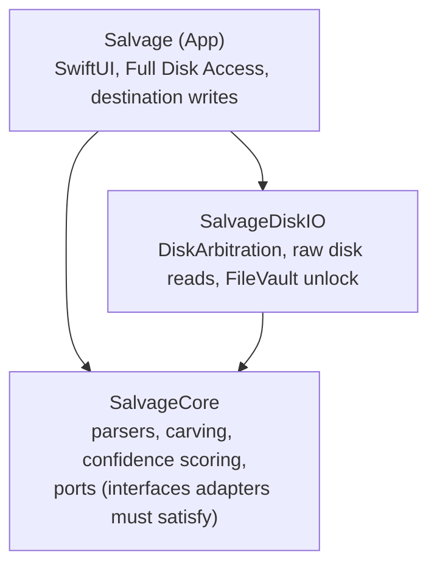

# Salvage architecture, in plain terms

This is the readable companion to `ARCHITECTURE-SPINE.md`. The spine is the terse, enforceable contract — every `AD-n` there is a rule that downstream code and contributors must follow. This document explains *why* those rules exist, for anyone landing in the repo who wants the story before the contract. If the two ever disagree, the spine wins; file an issue.

## What Salvage is

A native macOS app that recovers deleted or lost files — from a corrupted external drive, a formatted SD card, a disk whose partition silently vanished — fully offline, fully open source (MIT), with no telemetry and no paywall between finding your files and getting them back. The full product story lives in the PRD and brief; this document is about how it's built, not what it does or why it matters to users.

## The shape: three modules, one direction of dependency

- **`SalvageCore`** is the recovery engine: it knows how to read APFS/HFS+/FAT32/exFAT structures, carve files out of raw bytes when there's no filesystem metadata left, reconstruct a lost partition, and score how confident it is in each result. It doesn't know what a disk is — it just reads bytes it's handed.
- **`SalvageDiskIO`** is the one module that actually touches hardware: it finds disks, unmounts them, reads raw bytes off them, and unlocks FileVault volumes. It's macOS-specific.
- **`Salvage`** is the app you see: it shows SwiftUI views, prompts for Full Disk Access, and writes recovered files to wherever you choose.

Why split DiskIO from the App, instead of just "Core" and "App" like a lot of codebases do? Because disk access and UI are genuinely different jobs that change for different reasons. If Salvage ever gets a command-line sibling, or a Linux port, neither needs to touch SwiftUI or Core's recovery logic. The split isn't aesthetic; it's what makes those future moves cheap instead of a rewrite.

## The decision that matters most: how we read APFS without infringing on anyone

This is worth explaining because it's the single biggest engineering bet in the project, and it's not obvious why we made it.

Apple has never fully documented APFS's on-disk format. A few open-source projects have reverse-engineered enough of it to read files back — `apfs-fuse`, `libfsapfs`, parts of The Sleuth Kit — but every one of them is GPL or LGPL licensed. Salvage is MIT, and MIT and GPL don't mix if you're linking code together. We could have shelled out to one of those tools as a separate process (license boundaries are fine with that), but the most capable one, `apfs-fuse`, requires installing a FUSE kernel extension — a real install-friction and security-prompt hurdle for anyone just trying to get their photos back, and not something we wanted to ask of a privacy-conscious user on day one.

So Salvage writes its own APFS reader, from scratch, informed by what Apple *has* published (their 2018 APFS Reference) and by testing against real volumes. This is genuinely hard and genuinely the project's biggest risk — if you're picking up work here, this is where the time goes. It's flagged as an open assumption in the architecture spine (`AD-2`) specifically because it was a fast, AI-drafted call that deserves a second look before anyone writes code against it.

## How a scan actually flows

1. The app asks `SalvageDiskIO` to list devices. You pick one.
2. `SalvageDiskIO` unmounts it (so nothing else touches it during the scan) and starts streaming raw bytes to `SalvageCore`.
3. `SalvageCore` figures out what's there — intact files via filesystem metadata, carved files where metadata's gone, lost partitions hiding in unallocated space — and streams results back as they're found, not all at once at the end.
4. If it hits a FileVault-locked volume partway through (common inside a lost partition you didn't know was encrypted), the scan pauses and asks you to unlock it, then keeps going.
5. You pick what to recover; the app writes it to wherever you chose, never back to the disk you scanned from.

That "never writes to the disk you scanned from" part isn't just a promise in the UI — it's enforced by the code itself. The interface `SalvageCore` uses to read from a disk literally has no write method on it. There's no function to call even if a bug tried to.

## What's still open

- **The APFS reader's exact strategy** (above) — flagged, not yet spiked.
- **Whether Full Disk Access is strictly required** for the kind of raw device reads Salvage does. We couldn't confirm this from Apple's own documentation — only inferred it from how other tools in this space behave. Needs a hands-on check before anyone builds around the assumption.
- **A possible newer Apple framework (FSKit)**, shipped after this architecture was drafted — worth a look during that same hands-on check, in case it changes anything about how we talk to disks.

None of these block starting implementation on the parts that don't depend on them (the UI shell, the carving engine for the well-documented filesystems, the results browser) — but they do block calling the recovery engine "done."

## Where to look next

- **Product context, why this exists, who it's for:** the PRD and brief, linked from the spine's frontmatter.
- **The actual rules code must follow:** `ARCHITECTURE-SPINE.md` — every `AD-n` cited above has the enforceable version there.
- **What's deliberately not decided yet:** the spine's `Deferred` section.
