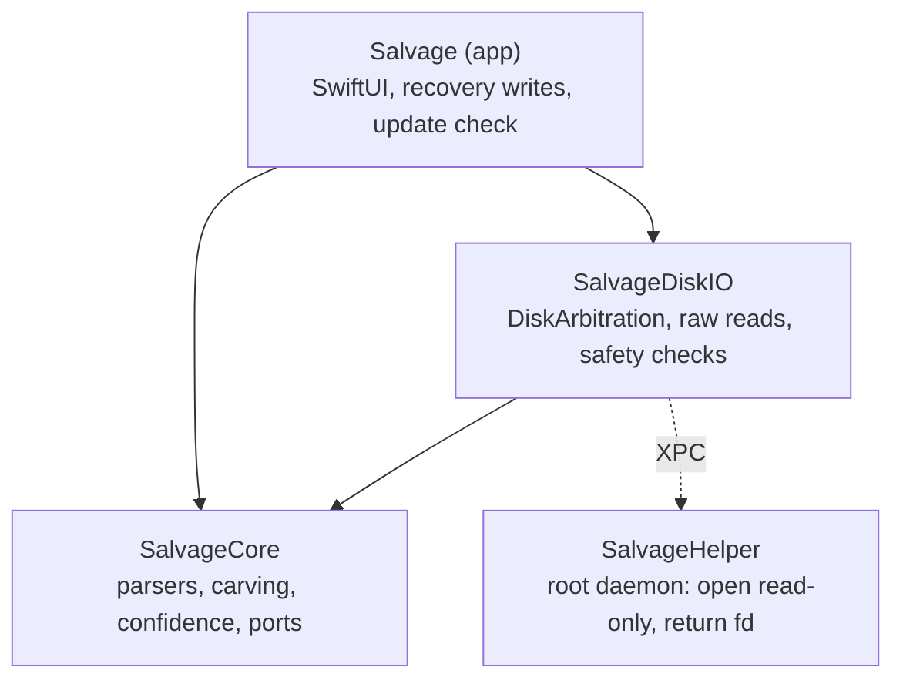

# Architecture overview

This is a short map of the code. The binding rules live in the planning documents. If this page
and they disagree, the spine wins, and where the code has since moved on, this page says so.

- **Architecture spine** (rules AD-1 to AD-13):
  [`ARCHITECTURE-SPINE.md`](../_bmad-output/planning-artifacts/architecture/architecture-DataRecoveryTool-2026-10-30/ARCHITECTURE-SPINE.md)
- **Architecture in plain terms** (the reasoning behind the rules):
  [`ARCHITECTURE.md`](../_bmad-output/planning-artifacts/architecture/architecture-DataRecoveryTool-2026-10-30/ARCHITECTURE.md)
- **Product requirements** (FR-1 to FR-19):
  [`prd.md`](../_bmad-output/planning-artifacts/prds/prd-DataRecoveryTool-2026-10-30/prd.md),
  and the [product brief](../_bmad-output/planning-artifacts/briefs/brief-DataRecoveryTool-2026-10-30/brief.md)
- **UX:** [`DESIGN.md`](../_bmad-output/planning-artifacts/ux-designs/ux-DataRecoveryTool-2026-10-31/DESIGN.md)
  (look) and [`EXPERIENCE.md`](../_bmad-output/planning-artifacts/ux-designs/ux-DataRecoveryTool-2026-10-31/EXPERIENCE.md)
  (behavior and copy)
- **Epics and stories:** [`epics.md`](../_bmad-output/planning-artifacts/epics.md). There is one
  implementation spec per story in
  [`_bmad-output/implementation-artifacts/`](../_bmad-output/implementation-artifacts/), and open
  follow-ups are in [`deferred-work.md`](../_bmad-output/implementation-artifacts/deferred-work.md).

## Modules

The design is hexagonal (ports and adapters), with dependencies pointing one way:

| Module | What it holds | Key files |
| --- | --- | --- |
| `SalvageCore` | Volume discovery (MBR/GPT, lost-partition search), parsers for FAT32/exFAT, NTFS, EXT2/3/4, HFS+ and APFS, APFS FileVault decryption, the carving engine and its JSON signatures, recovery confidence, and the `BlockReader` port. Foundation only. | `ScanSession.swift`, `Parsers/`, `Carving/`, `Confidence/RecoveryConfidence.swift`, `Ports/BlockReader.swift` |
| `SalvageDiskIO` | The device list and tree, unmounting, `RawBlockReader` (read-only, validated descriptor), the boot-disk check, recovery-destination safety, and the helper client. | `RawBlockReader.swift`, `DeviceWatcher.swift`, `DeviceTree.swift`, `BootDiskSafety.swift`, `DestinationSafety.swift`, `PrivilegedOpenClient.swift`, `HelperShared/` |
| `Salvage` (app) | SwiftUI views, view models, recovery writing, and the one network file. `ContentView` is the composition root, the only place a `RawBlockReader` is handed to a `ScanSession`. | `Views/`, `ViewModels/`, `Updates/UpdateChecker.swift` |
| `SalvageHelper` | A launchd daemon registered with `SMAppService`. Its one operation opens a validated whole disk `O_RDONLY` and returns the descriptor. It compiles only `main.swift` and `SalvageDiskIO/.../HelperShared/`. | `SalvageHelper/main.swift`, `dev.hsmith.Salvage.Helper.plist` |

## Rules enforced in CI

`.github/workflows/ci.yml` runs these on every push and pull request:

- **AD-9, the module boundary:** `scripts/check-core-boundary.sh`. SalvageCore never imports
  AppKit, SwiftUI or IOKit. DiskArbitration is imported only in SalvageDiskIO. No transitive
  dependency of SalvageCore needs those frameworks.
- **AD-12, zero network:** `scripts/check-no-network.sh`. See [PRIVACY.md](PRIVACY.md#how-this-is-enforced).
- **The project file matches `project.yml`:** `scripts/check-xcodeproj-sync.sh`, with xcodegen
  pinned and checksum-verified.
- Every checker has a self-test (`scripts/test-check-*.sh`) that plants a violation.
- Build and test of both packages, the spike harness, and an unsigned Debug app build. CI also
  checks that the helper is embedded at `Contents/MacOS/SalvageHelper` with its plist in
  `Contents/Library/LaunchDaemons/`.

`.github/workflows/release.yml` (AD-10) runs on a `v*.*.*` tag. It signs with Developer ID,
verifies the nested helper's identifier, Team ID, hardened runtime and timestamp, and checks the
helper's SpawnConstraint team (`scripts/check-helper-signing-team.sh`). It then notarizes, staples
and publishes the zip with a SHA-256 checksum.

## How a scan flows

1. `DeviceWatcher` (DiskArbitration) feeds the device tree. `UnlockViewModel` may offer the
   FileVault sheet first.
2. `RawBlockReader.prepare` checks the drive identity, refuses the boot disk, unmounts it, confirms
   it is unmounted, then opens `/dev/rdiskN` directly. On `EACCES`/`EPERM` it asks the helper. It
   then checks that the descriptor is read-only and is the expected device.
3. `ScanSession.run` discovers volumes, runs each parser (emitting `ScanEvent.found`), then sweeps
   the volumes' bytes for the carver. Progress, checkpoints and `ScanNotice`s travel on their own
   streams (AD-11).
4. After the scan, the open read-only session (`SourceSession`) stays alive for preview
   (`PreviewLoader`) and recovery (`RecoveryCoordinator`). Recovery checks the destination with
   `DestinationSafety` when it is chosen and again before writing (AD-8).

## Where the code has moved past the planning documents

- **FileVault unlock (AD-3).** The spine places FileVault unlock in SalvageDiskIO. Since Story 2.5,
  the app checks credentials and decrypts in **SalvageCore**
  (`Parsers/APFSCrypto.swift`, `EncryptedVolumeUnlock`), from the container's raw bytes, without
  mounting and without `diskutil`. `SalvageDiskIO/FileVaultUnlocker.swift`, the Story 2.4
  `diskutil apfs unlockVolume -nomount` path, is still in the package, but the app doesn't call it.
- **Encrypted volumes found mid-scan (AD-11).** The spine says the scan pauses on `.unlockRequired`.
  In the code, the parser skips the locked volume and the scan carries on. When it ends, the app
  offers the unlock sheet for each such volume and re-scans the drive with the volume unlocked
  (`ContentView`, `UnlockViewModel`).
- **Full Disk Access.** The plain-terms architecture doc describes the app as prompting for Full
  Disk Access. The app has no such prompt. Physical drives are read through the helper (AD-13),
  and the Full Disk Access text appears only as the `ScanError.permissionDenied` message.
